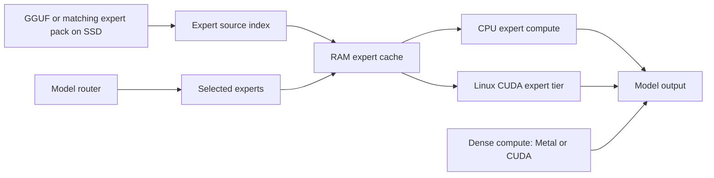

<!-- SPDX-License-Identifier: Apache-2.0 -->
# How it works

[Back to README](../README.md)

The model router chooses the experts needed by each token. InferSSD manages how those expert weights are indexed, read from SSD, cached and executed.

## Expert sources and caching

Source indexes locate expert byte ranges in the original GGUF files or a matching v1 expert pack. Indexing GGUF headers does not copy the model payload. Packs group expert slices by layer and expert with **4 KiB alignment**, preserving the existing quantized bytes. The v1 format has no checkpoint fingerprint, so keep each pack paired with its source checkpoint.

The runtime owns immutable source metadata, readers, host-budget accounting and telemetry for each context. Executors borrow those services. Linux and Windows run configured experts on the CPU sink, which reads through the OS read ring (`io_uring` on Linux, IoRing on Windows) into its RAM cache; Linux adds the CUDA cache tier. macOS still uses its native reader and cache path with an RSS guard; the sink builds and is tested there. Device and source validation remains necessary for the selected configuration.

## Threads

CPU compute runs on one pool, ggml's threadpool, for dense and expert work alike. A sink node is an ordinary multi-threaded ggml op: every CPU-backend thread of the graph enters it, thread 0 opens a call for the node's thread count and runs the layer, and the other threads join the call as its compute participants until it closes. Each compute phase splits its rows over the participants, by atomic row chunks or explicit row weights; a decode phase uses the first N of them, where N is all of them or the number that fits the fastest CPU cluster, whichever measures faster, or `cpu.decode_participants`. Grouped prefill and the cache executor dispatch through the same phases. The participants take no lock: thread 0 publishes each phase in one atomic word, and the others park on it through the OS's wait-on-address primitive between phases, so one wake reaches all of them.

Placement is ggml's. `-t` and `-tb` set the decode and batch thread counts, `-C` and `-Cb` their CPU masks, and `--cpu-strict` and `--cpu-strict-batch` place thread i on the i-th CPU of its mask in increasing order; `--prio` and `--poll` set priority and polling. The sink keeps only its own I/O thread, its prefetch readers and, on unified memory, a watch thread, all placed by `cpu.io_cpus`.

## Batching

Prompt batching lets tokens share weight access. `inferssd launch --batch` and `--ubatch` set the native batch and micro-batch capacities. The Linux controller consumes native telemetry to inform placement and prefill decisions; see [controller observations](architecture/controller-observations.md).

On macOS the launcher supports static settings only; it does not include an online adaptive controller. The settings used in the recorded Mac benchmark runs are listed in [benchmark methodology](benchmark.md#engine-configurations).

## Modules

The runtime extends the bundled llama.cpp snapshot. Its integration points are listed in [upstream patches](development/upstream-patches.md).

| Layer | Directory | Owns |
| --- | --- | --- |
| Core | `engine/ggml/src/ggml-ssd/store` | Immutable per-context source indexes and explicit pack/alias parsing |
| Core | `engine/ggml/src/ggml-ssd/io` | Independent syscall and liburing readers; portable pread |
| Core | `engine/ggml/src/ggml-ssd/host` | Process host arbiter, per-context leases, expert cache and page accounting |
| Core | `engine/ggml/src/ggml-ssd/place` | Shared placement cost evaluation, learning state and prefetch decisions |
| Core | `engine/ggml/src/ggml-ssd/stream` | Expert ranges, dense lookahead, seed ordering and copy observations |
| Core | `engine/ggml/src/ggml-ssd/settings`, `telemetry` | Immutable validated settings, source receipts and owned JSONL writers |
| Executors | `engine/ggml/src/ggml-cpu/ssd`, `engine/ggml/src/ggml-cuda/ssd` | CPU scheduling and compute; CUDA tier, staging, events and format kernels |
| Runtime | `engine/src/ssd` | Context assembly, backend registry binding, model sources, model adaptation, graph admission and diagnostics |
| llama extensions | `engine/src/inferssd` | KV state codecs and positional state serialization |
| Common | `engine/common/inferssd` | CLI glue, model chat parsing, reasoning budgets |
| Server | `engine/tools/server/inferssd` | Prompt cache, checkpoints and request lifecycle |
| Framework | `framework/src/inferssd` | Standard-library Python package: GGUF and pack metadata preparation (`source/`), probes, plans, typed settings (`configuration/`) and owned launch (`launch/`) |

## Dependency direction

Core code depends only on ggml-base and platform facilities. A CPU executor never links CUDA; a CUDA executor never links CPU. The runtime obtains immutable, size-checked provider tables from the same build through the ordinary backend registries and supplies context-owned services. The scheduler calls a borrowed hook table, so ggml-base has no dependency on the core implementation. Kernels stay in their backend.

Model-specific SSD requirements are described in `engine/src/ssd/model-adapter.h`: expert layout and quantization relationships, and activation and normalization requirements, are validated before the shared MoE bridge creates an executor node. The context uses the same descriptor for its early support check. Executors consume validated operations rather than model identities; the ordinary shared MoE implementation remains in place.

`engine/ggml/src/ggml-ssd/place/runtime-policy.h` owns numeric learning state and placement and prefetch decisions. Executors supply workload, resource and measured cost inputs, execute the returned request and rank plans using their own caches, readers and workers, then publish feedback at fixed update points. Policy code holds no sink, device, file or worker handles. All executors share one placement evaluator, so they apply the same cost arithmetic and selection thresholds.

Run `python3 scripts/inferssd/check-layering.py` to check these boundaries.

## Runtime ownership

The context owns sources, host registration, the telemetry writer, transport and diagnostics; executors borrow them. Graph failure fences outstanding seed consumers before reset. A precompute transaction restores touched and purged KV metadata without allocating, and it ends before compute submission. Stateful memory that cannot roll back a submitted failure clears the affected sequences for checkpoint restore or replay. Backend destruction quiesces transport before destroying CUDA streams. The writer and source descriptors close after all borrowers stop.

Allocation admission precedes allocation and first touch; committed allocations invalidate learning intervals when they are later freed or replaced. Linux uses finite cgroup constraints; the Mac cache keeps its platform RSS guard.

## Settings and deployment

Production configuration uses the typed `inferssd-settings 1` format described in [configuration](configuration.md). Retired environment names are rejected by name without reporting their values. Only `INFERSSD_DEBUG` and `INFERSSD_TRACE_DIR` are observation channels, and trace or profile output requires an owned telemetry writer. Options inherited from llama.cpp keep their upstream behavior.

Deployment paths and capabilities are declared as explicit [engine resources](engine-resources.md), so the installed framework needs no source checkout. Native probes live in `engine/tools/inferssd-probe` and run only when requested.

The DeepSeek and Muse benchmark configurations retain native expert routing. Throughput alone does not establish model quality; record numerical checks, exact settings and workload evidence alongside each experiment.
