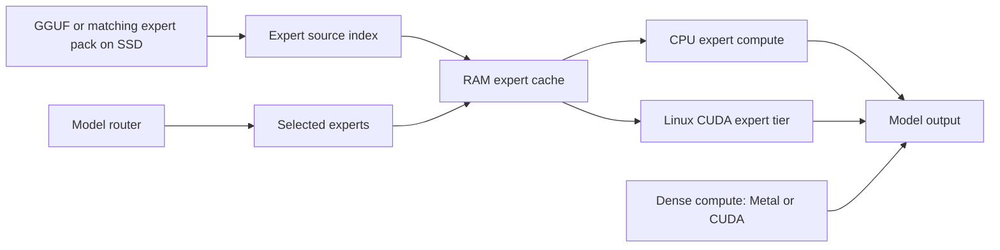

<!-- SPDX-License-Identifier: Apache-2.0 -->
# How it works

[Back to README](../README.md)

The model router chooses the experts needed by each token. WICI-InferSSD manages how those expert weights are indexed, read from SSD, cached and executed.

## Expert sources and caching

Source indexes locate expert byte ranges in the original GGUF files or a matching v1 expert pack. Indexing GGUF headers does not copy the model payload. Packs group expert slices by layer and expert with **4 KiB alignment**, preserving the existing quantized bytes. The v1 format has no checkpoint fingerprint, so keep each pack paired with its source checkpoint.

The runtime owns immutable source metadata, readers, host-budget accounting and telemetry for each context. Executors borrow those services. Linux uses `io_uring` and CPU/CUDA cache tiers; macOS uses its native reader and cache path with an RSS guard. Device and source validation remains necessary for the selected configuration.

## Batching

Prompt batching lets tokens share weight access. `inferssd launch --batch` and `--ubatch` set the native batch and micro-batch capacities. The Linux controller consumes native telemetry to inform placement and prefill decisions; see [controller observations](architecture/controller-observations.md).

The current Mac launcher supports static settings; online Mac adaptation is deferred. The experimental environment-based adaptive prefill controller in the earlier Mac branch belongs to the historical benchmark implementation. Its recorded configuration is described in [benchmark methodology](benchmark.md#engine-configurations), rather than exposed as a current launch option.

## Source map

This repository separates the native engine from the Python framework:

| Component | Entry point |
| --- | --- |
| GGUF and pack metadata preparation | `framework/src/inferssd/source/` |
| Source indexes and readers | `engine/ggml/src/ggml-ssd/store/`, `engine/ggml/src/ggml-ssd/io/` |
| Host accounting and expert cache | `engine/ggml/src/ggml-ssd/host/` |
| Placement and streaming policy | `engine/ggml/src/ggml-ssd/place/`, `engine/ggml/src/ggml-ssd/stream/` |
| CPU and CUDA executors | `engine/ggml/src/ggml-cpu/ssd/`, `engine/ggml/src/ggml-cuda/ssd/` |
| Model adaptation and context ownership | `engine/src/ssd/` |
| Server request lifecycle | `engine/tools/server/inferssd/` |
| Typed settings and owned launch | `framework/src/inferssd/configuration/`, `framework/src/inferssd/launch/` |

See the [architecture reference](../ARCHITECTURE.md) for ownership and layering, [configuration](configuration.md) for the typed settings contract, and [runtime resources](engine-resources.md) for deployment. The original [readme-test architecture](https://github.com/wici-ai/ssd-llama/blob/a755355f82bcc52869dd3c1085db59210ced068b/docs/architecture.md) describes the earlier source layout.

The DeepSeek and Muse benchmark configurations retain native expert routing. Throughput alone does not establish model quality; record numerical checks, exact settings and workload evidence alongside each experiment.
