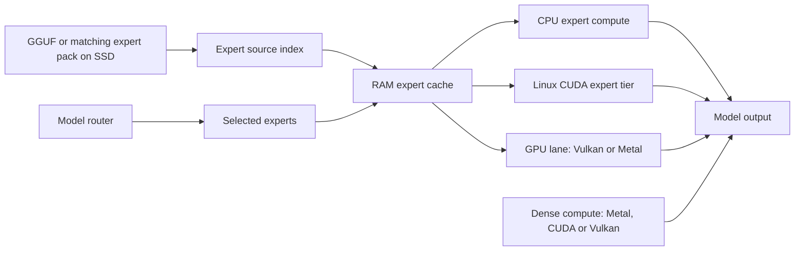

<!-- SPDX-License-Identifier: Apache-2.0 -->
# How it works

[Back to README](../README.md)

The model router chooses the experts needed by each token. InferSSD manages how those expert weights are indexed, read from SSD, cached and executed.

## Expert sources and caching

Source indexes locate expert byte ranges in the original GGUF files or a matching v1 expert pack. Indexing GGUF headers does not copy the model payload. Packs group expert slices by layer and expert with **4 KiB alignment**, preserving the existing quantized bytes. The v1 format has no checkpoint fingerprint, so keep each pack paired with its source checkpoint.

The runtime owns immutable source metadata, readers, host-budget accounting and telemetry for each context. Executors borrow those services. Linux, macOS and Windows run configured experts on the same CPU sink, which reads through the OS read ring (`io_uring` on Linux, IoRing on Windows, persistent reader threads with `F_NOCACHE` on macOS) into its RAM cache; with CUDA, Linux adds the GPU cache tier. A GPU backend without that tier, such as Metal, runs the dense layers, and the sink computes the routed experts on the CPU, but for a prompt's heavy experts on a GPU that shares host memory ([the GPU lane](#the-gpu-lane)). Device and source validation remains necessary for the selected configuration.

## The GPU lane

A GPU that shares host memory and has no CUDA tier takes the heavy experts of a prompt pass through the graph lane (`ggml/src/ggml-ssd/gpu/graph-lane.cpp`), on Vulkan and Metal alike. The lane is written over the ordinary ggml backend interface: it reads the weights in place from the read ring, runs up, gate, the activation and down as one graph over the experts whose reads have landed, and adds the rows into the pass's output. An expert with many tokens costs the GPU far less than the CPU: one matrix is read once for all its rows.

The sink's cost table chooses the experts, from the lines it measures while the pass runs, exactly as it does for the CUDA tier. The lane holds nothing across layers, so decode stays on the CPU, where one row per expert favours it, and the host budget is unchanged. A pass limited by the drive moves little: its compute is already hidden behind its reads.

The first successful graph containing a new weight-format pair, geometry, activation kind or exact expert row count stays out of the steady cost fit. Its execution time and expert/route counts remain in the request's measurements; later graphs of warmed shapes supply fit observations.

`vram.budget = 0` keeps every expert on the CPU. A pass whose working memory the host budget refuses stays on the CPU by itself. The lane supplies F32 input tensors to ggml, but quantized weight kernels may quantize the input and hidden activations internally for integer dot products. CPU and lane rows can differ with the backend's precision, and the plan depends on measured times, so a reply can differ between runs where the lane is in use.

## Threads

CPU compute runs on one pool, ggml's threadpool, for dense and expert work alike. A sink node is an ordinary multi-threaded ggml op: every CPU-backend thread of the graph enters it, thread 0 opens a call for the node's thread count and runs the layer, and the other threads join the call as its compute participants until it closes. Each compute phase splits its rows over the participants, by atomic row chunks or explicit row weights; a decode phase uses all of them, or the first `cpu.decode_participants`. A call closes only once every thread of the node has joined it and ggml's barrier after the node waits for each one, so the launch sizes the decode pool to the fewest threads that stream the experts' weights at the best measured rate: past that, memory bandwidth adds nothing and each thread only adds a wait. Between decode tokens the sink also measures the busy time of the CPUs the process may run on that the graph's threads did not take (the GPU backend's threads, the reads, other processes): a decode graph then runs on the pool's threads less that many CPUs, rounded up, and the threads it leaves out wait without polling, since another thread taking a graph thread's CPU would hold that layer's barrier. Grouped prefill and the cache executor dispatch through the same phases. The participants take no lock: thread 0 publishes each phase in one atomic word, and the others poll it for up to 3 ms after a phase, then park on it through the OS's wait-on-address primitive, so one wake reaches all of them.

Placement is ggml's. `-t` and `-tb` set the decode and batch thread counts, `-C` and `-Cb` their CPU masks, and `--cpu-strict` and `--cpu-strict-batch` place thread i on the i-th CPU of its mask in increasing order; `--prio` and `--poll` set priority and polling. The sink keeps only its own I/O thread, its prefetch readers and, on unified memory, a watch thread, all placed by `cpu.io_cpus`.

Thread 0 launches a decode layer's work on the CUDA cache tier itself. The tier's worker and upload threads run on the process's CPUs other than thread 0's (all of them when none is left), set at the tier's first layer and again whenever thread 0's change.

## Batching

Prompt batching lets tokens share weight access. The launch strategy sets the native batch and micro-batch capacities. Each launch's settings stay fixed while it runs; the engine itself sizes its caches to the machine as it goes. A run's native events record placement and prefill; see [native observations](architecture/native-observations.md). The settings used in the recorded Mac benchmark runs are listed in [benchmark methodology](benchmark.md#engine-configurations).

## Modules

The runtime extends the bundled llama.cpp snapshot. Its integration points are listed in [upstream patches](development/upstream-patches.md).

| Layer | Directory | Owns |
| --- | --- | --- |
| Core | `engine/ggml/src/ggml-ssd/store` | Immutable per-context source indexes and explicit pack/alias parsing |
| Core | `engine/ggml/src/ggml-ssd/io` | One read ring per OS (io_uring through system calls, IoRing, reader threads), an instance per reader; portable pread |
| Core | `engine/ggml/src/ggml-ssd/host` | Process host arbiter, per-context leases, expert cache and page accounting |
| Core | `engine/ggml/src/ggml-ssd/place` | Shared placement cost evaluation, learning state and prefetch decisions |
| Core | `engine/ggml/src/ggml-ssd/stream` | Expert ranges, dense lookahead, seed ordering and copy observations |
| Core | `engine/ggml/src/ggml-ssd/settings`, `telemetry` | Immutable validated settings, source receipts and owned JSONL writers |
| Executors | `engine/ggml/src/ggml-cpu/ssd`, `engine/ggml/src/ggml-cuda/ssd` | CPU scheduling and compute; CUDA tier, staging, events and format kernels |
| Runtime | `engine/src/ssd` | Context assembly, backend registry binding, model sources, model adaptation, graph admission and diagnostics |
| llama extensions | `engine/src/inferssd` | KV state codecs and positional state serialization |
| Common | `engine/common/inferssd` | CLI glue, model chat parsing, reasoning budgets |
| Server | `engine/tools/server/inferssd` | Prompt cache, checkpoints and request lifecycle |
| Framework | `framework/src/inferssd` | Standard-library Python package: GGUF and pack metadata preparation (`source/`), probes, plans, typed settings (`configuration/`) and owned launch (`launch/`) |

## Dependency direction

Core code depends only on ggml-base and platform facilities. A CPU executor never links CUDA; a CUDA executor never links CPU. The runtime obtains immutable, size-checked provider tables from the same build through the ordinary backend registries and supplies context-owned services. The scheduler calls a borrowed hook table, so ggml-base has no dependency on the core implementation. Kernels stay in their backend.

Model-specific SSD requirements are described in `engine/src/ssd/model-adapter.h`: expert layout and quantization relationships, and activation and normalization requirements, are validated before the shared MoE bridge creates an executor node. The context uses the same descriptor for its early support check. Executors consume validated operations rather than model identities; the ordinary shared MoE implementation remains in place.

`engine/ggml/src/ggml-ssd/place/runtime-policy.h` owns numeric learning state and placement and prefetch decisions. Executors supply workload, resource and measured cost inputs, execute the returned request and rank plans using their own caches, readers and workers, then publish feedback at fixed update points. Policy code holds no sink, device, file or worker handles. All executors share one placement evaluator, so they apply the same cost arithmetic and selection thresholds.

Run `python3 scripts/inferssd/check-layering.py` to check these boundaries.

## Runtime ownership

The context owns sources, host registration, the telemetry writer, transport and diagnostics; executors borrow them. Graph failure fences outstanding seed consumers before reset. A precompute transaction restores touched and purged KV metadata without allocating, and it ends before compute submission. Stateful memory that cannot roll back a submitted failure clears the affected sequences for checkpoint restore or replay. Backend destruction quiesces transport before destroying CUDA streams. The writer and source descriptors close after all borrowers stop.

Allocation admission precedes allocation and first touch; committed allocations invalidate learning intervals when they are later freed or replaced. An admission that does not fit first has the context's expert caches give room back: the executor registers their reclaimer with the context's host client, so every allocation, including the CPU backend's work buffer, gets that room without asking for it. Linux uses finite cgroup constraints; macOS and Windows use the process envelope described in [configuration](configuration.md).

## Settings and deployment

Production configuration uses the typed `inferssd-settings 1` format described in [configuration](configuration.md). Retired environment names are rejected by name without reporting their values. Only `INFERSSD_DEBUG` and `INFERSSD_TRACE_DIR` are observation channels, and trace or profile output requires an owned telemetry writer. The server's `INFERSSD_USAGE_DIR` selects where it records [usage events](usage-events.md) for its host. Options inherited from llama.cpp keep their upstream behavior.

Deployment paths and capabilities are declared as explicit [engine resources](engine-resources.md), so the installed framework needs no source checkout. Native probes live in `engine/tools/inferssd-probe` and run only when requested.

The DeepSeek and Muse benchmark configurations retain native expert routing. Throughput alone does not establish model quality; record numerical checks, exact settings and workload evidence alongside each experiment.
